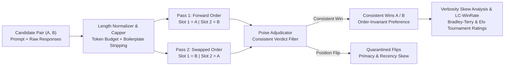

# poise: TideOS Eval Kit (Tool 10)

<div align="center">

**Control LLM judge position bias, length skew, and verbosity in pairwise A/B comparisons: double-blind swapped order evaluation, consistent verdict adjudication, deterministic length capping, and length-controlled win rates.**

[](https://github.com/TechTideOhio/poise/actions/workflows/ci.yml)
[](https://github.com/TechTideOhio/poise/releases/latest)
[](LICENSE)
[](Cargo.toml)
[](Cargo.toml)

[Quickstart](#60-second-quickstart) | [Why poise?](#why-poise) | [Position Bias & Verbosity Table](#position-bias-and-verbosity-skew-distortion) | [Architectural Foundations](#architectural-foundations--engineering-syntheses) | [Feature Matrix](#feature-comparison-matrix) | [The Complete TideOS Eval Kit](#the-complete-tideos-eval-kit) | [About](#about) | [Contributing](CONTRIBUTING.md)

</div>

---

## Why poise?

While Tool 9 (`gavel`) calibrates pointwise binary (`PASS`/`FAIL`) LLM judges, engineering teams frequently rely on **pairwise A/B comparisons** when evaluating open-ended generation, refactoring diffs, architecture proposals, or head-to-head agent runs (`claude` vs `codex` vs `cursor`). Relative preference is often easier to formulate than an absolute threshold.

However, naive single-pass pairwise LLM judges exhibit two fatal systemic biases that corrupt production decisions:

1. **Position Bias (Primacy / Recency Slot Preference)**:
   LLM judges systematically favor whichever response is placed in **Slot 1** (primacy bias, prevalent in Claude and GPT models) or **Slot 2** (recency bias) regardless of output quality. A single-pass evaluation that presents Candidate A in Slot 1 and Candidate B in Slot 2 inflates Candidate A with an artificial 15% to 30% phantom win rate.
2. **Verbosity Bias (Length Inflation Skew)**:
   LLM judges equate longer, more verbose responses (padded markdown headers, redundant lists, boilerplate preambles) with superior capability, even when the extra tokens contain zero new technical information or violate conciseness guidelines.

In classical analytical metrology, **Gauss's method of double weighing** (1820) eliminates balance-beam lever-arm asymmetry by weighing two objects on Pan 1 and Pan 2, then **swapping the pans** and weighing again. Named after the sliding counterweight on an assay balance beam (**`poise`** / *equipoise*), `poise` brings double-weighing rigor and length control to pairwise LLM evaluations:
- Runs every A/B comparison **twice with swapped order**: **Forward Pass** $(A \text{ in Slot 1}, B \text{ in Slot 2})$ and **Swapped Pass** $(B \text{ in Slot 1}, A \text{ in Slot 2})$.
- Counts **only consistent verdicts**: Candidate $A$ wins only if Pass 1 chooses Slot 1 ($A$) and Pass 2 chooses Slot 2 ($A$). Position flips (where both passes pick Slot 1 or both pick Slot 2) are quarantined as `InconsistentFlip` artifacts and never credited as decisive wins.
- Applies **deterministic length normalization and budget capping** (`max_tokens`, `max_chars`, boilerplate fluff stripping) before judging, and computes **Verbosity Correlation ($r_{\text{len}}$)** and **Length-Controlled Win Rate ($\text{LC-WinRate}$)** via logistic regression on consistent outcomes to eliminate length advantage.
- Computes regularized **Bradley-Terry strengths ($\pi_i$)** and **Elo tournament ratings** with non-parametric bootstrap 95% confidence intervals ($B = 2000$) over consistent pairs.



---

## Position Bias and Verbosity Skew Distortion

When an uncalibrated single-pass judge evaluates candidate pairs, slot preference and response length manufacture massive phantom advantages over true model capability:

| Scenario / Comparison | True Win Rate (A) | Naive Single-Pass (A in Slot 1) | Swapped Consistency ($C_{\text{swap}}$) | Poise LC-WinRate ($\Delta L = 0$) | Operational Diagnosis |
|---|:---:|:---:|:---:|:---:|---|
| **Symmetric Fair Models (50/50)** | 50.0% | **70.0%** (+20% Slot 1 Bias) | 60.0% (40% Flips) | **50.0%** (Order Safe) | Primacy Mirage: Identical models appear unequal |
| **Slightly Worse Model in Slot 1** | 40.0% | **62.0%** (+22% Slot 1 Bias) | 56.0% (44% Flips) | **40.0%** (Debiased) | False Ship Trap: Inferior prompt deployed |
| **Padded Verbose Challenger** | 50.0% | **68.0%** (+18% Verbosity Skew) | 90.0% (Consistent Bias)| **50.0%** (Zero Length Adv) | Verbosity Inflation: Boilerplate rewarded over conciseness |
| **Slot 1 + Verbose Double Mirage** | 45.0% | **82.0%** (+37% Compound Bias) | 52.0% (Severe Flips) | **45.0%** (True Capability)| Catastrophic Mirage: Biased judge masks regression |
| **Clear Superior Model in Slot 2** | 80.0% | **62.0%** (-18% Penalized) | 78.0% (Partial Flips) | **80.0%** (Unsuppressed) | False Alarm Trap: Genuine breakthrough obscured |

---

## Architectural Foundations & Engineering Syntheses (Alex Cinovoj / TechTideAI)

`poise` incorporates Alex Cinovoj's three core engineering pillars for pairwise LLM judge bias control:

### 1. Extreme Craft & Desktop Ergonomics (Alex Cinovoj / @steipete Synthesis)
- **Sub-2 MB Standalone Binary**: Compiled to `1.89 MB` with `opt-level = "z"`, `lto = true`, and `strip = true`.
- **Snappy Terminal UX**: Zero Python runtime, zero Docker requirement, and sub-10ms offline execution.
- **Audio Notification**: Emits `\x07` terminal alert the instant a position flip gate, verbosity threshold, or critique-before-verdict check trips.
- **Desktop Ergonomics**: Clean ASCII distortion physics table with `poise table` displaying position and length bias mechanics without fluff.

### 2. Production vs Demo Observability (Alex Cinovoj / @hwchase17 Synthesis)
- **W3C OpenTelemetry / OpenInference Export**: Generates compliant trace spans with `eval.swap_consistency_rate`, `eval.flip_rate`, `eval.position_bias_index`, `eval.swap_kappa`, `eval.raw_win_rate_a`, `eval.length_controlled_win_rate_a`, `eval.length_correlation_r`, and `eval.verbosity_inflation_delta`.
- **Pre-Judge Capping vs Post-Judge Logistic Debiasing**: Provides defense-in-depth by physically capping tokens pre-judge (`poise normalize`) and mathematically isolating true preference at zero length difference post-judge (`LC-WinRate`).
- **Multi-Agent Harness Ingestion**: Ingests multi-agent session pairs directly from `Tools/agent-harness/runs` (`poise ingest`) to benchmark agents head-to-head on real repository tasks.
- **Pairwise Economics Modeling**: Models the token cost of double-pass evaluation versus the catastrophic engineering cost of shipping a regression due to position mirages.

### 3. Mathematical Rigor & Provenance Ledgers (Alex Cinovoj / @orneryd Synthesis)
- **Gauss's Double-Weighing Principle**: Eliminates presentation slot asymmetry by requiring both Forward and Swapped presentations. Only position-invariant verdicts are accepted.
- **Bradley-Terry & Elo Tournament Solver**: Fits regularized Bradley-Terry strengths ($\pi_m$) via Minorization-Maximization (MM) and Elo tournament ratings over consistent pairwise outcomes across $M \ge 2$ candidates.
- **Non-Parametric Bootstrap 95% Confidence Intervals**: Runs 2,000 deterministic `SplitMix64` resamples to compute exact 95% confidence intervals on both `LC-WinRate` and Elo ratings.
- **Sequential Merkle Provenance Chaining**: Chains every pairwise double-pass record via $H(\text{prev\_hash} \parallel \text{pair\_payload})$ with domain tag `b"tideos-poise-pair-v1\0"`.
- **sha256-framed-v1 Lockfiles**: Domain-separated, length-prefixed cryptographic lockfiles prevent tampering with rubric criteria, test datasets, or gating bounds (`poise lock` / `poise verify`).
- **Exhaustive Regime Classification**: Classifies pairwise evaluation runs into `EquilibriumPoised`, `PrimacyBiasSkewed`, `RecencyBiasSkewed`, `VerbositySkewDistorted`, `LengthBudgetExceeded`, `MissingSwappedPassBlocked`, `CritiqueOrderBlocked`, `UnpinnedModelBlocked`, and `InsufficientPairsBlocked`.

---

## Feature Comparison Matrix

| Capability | `poise` (TideOS) | LangSmith / Tracing | Chatbot Arena / LMSYS | Promptfoo | PyTest / Unit Tests |
|---|:---:|:---:|:---:|:---:|:---:|
| **Double-Blind Swapped Evaluation** | **Yes** (Automated) | Manual script | Human crowdsourced | Manual config | No |
| **Consistent Verdict Adjudication** | **Yes** (Flips quarantined) | No | No | Partial | No |
| **Deterministic Length Capping** | **Yes** (Pre-eval budget) | No | No | No | No |
| **Length-Controlled Win Rate (LC-WinRate)** | **Yes** (Logistic $\Delta L=0$) | No | Length stratification | No | No |
| **Bradley-Terry & Elo Tournament Solver** | **Yes** (Bootstrap 95% CI) | Metrics only | Elo only | No | No |
| **Critique-Before-Verdict Byte Check** | **Yes** (Offset audit) | No | No | Partial | No |
| **Pinned Model & Temp=0 Enforcement** | **Yes** (Regex audit) | No | No | No | No |
| **Sequential Merkle Provenance Chaining**| **Yes** (SHA-256) | Run IDs | No | No | No |
| **Single Standalone Static Binary** | **Pure Rust** (1.89 MB) | Cloud SaaS | Web Platform | Node.js runtime | Python runtime |

---

## Core Capabilities

1. **Double-Blind Swapped Presentation Protocol**:
   Evaluates every candidate pair in both Forward $(A=\text{Slot 1}, B=\text{Slot 2})$ and Swapped $(B=\text{Slot 1}, A=\text{Slot 2})$ orientations to cancel model slot preferences.
2. **Consistent Verdict Adjudication Filter**:
   Quarantines inconsistent position flips (`InconsistentPrimacyFlip`, `InconsistentRecencyFlip`, `InconsistentPartialFlip`). A candidate receives a decisive win only if chosen in both orientations.
3. **Deterministic Length Normalization & Capping**:
   Enforces configurable token (`max_tokens`), character, and line budgets on clean boundaries and strips boilerplate introductory filler before judging.
4. **Length-Controlled Win Rate ($\text{LC-WinRate}$)**:
   Fits a two-parameter logistic model $P(A \succ B \mid \Delta L) = \sigma(\beta_0 + \beta_{\text{len}} \Delta L)$ over consistent outcomes to compute the debiased win rate at zero length difference ($\sigma(\hat{\beta}_0)$).
5. **Verbosity Skew Correlation ($r_{\text{len}}$)**:
   Measures the Pearson correlation between normalized length delta and outcome score to detect whether longer responses receive unearned preference.
6. **Bradley-Terry & Elo Tournament Ratings**:
   Computes regularized Bradley-Terry strengths and Elo ratings across $M \ge 2$ models or agents over consistent pairs with 2,000-iteration bootstrap 95% confidence intervals.
7. **Critique-Before-Verdict Byte-Order Audit**:
   Verifies that in both passes, the serialized output places `"critique"` strictly before `"verdict"` to prevent autoregressive rationalization.
8. **Pinned Model Snapshot & Zero-Temperature Gate**:
   Rejects unpinned model aliases (`gpt-4o`, `claude-3-5-sonnet`, `*-latest`) and non-zero temperatures.
9. **sha256-framed-v1 Cryptographic Lockfiles**:
   Pins test suites, rubric texts, dataset paths, and parameter digests with domain-tagged length-prefixed SHA-256 digests (`poise lock` / `poise verify`).

---

## 60-Second Quickstart

### 1. View the Position Bias Distortion Physics Table
```bash
poise table
```

### 2. Scaffold a Starter Soft Factory Pack
```bash
poise init --pack softfactory --out packs/softfactory.toml
```

### 3. Normalize and Cap Response Lengths
```bash
poise normalize --input pairs.raw.jsonl --out pairs.capped.jsonl --max-tokens 180 --strip-fluff
```

### 4. Score Double-Blind Pairwise Comparisons Against a Suite Case
```bash
poise score --suite packs/softfactory.toml --case sf-vsp-rls-migration-ab
```

### 5. Rank Competing Agents / Models via Tournament Ratings
```bash
poise rank --pairs packs/fixtures/vsp_rls_ab_60.jsonl --bootstrap-iterations 2000
```

### 6. Run All Suite Cases and Verify Gating Thresholds
```bash
poise check --suite packs/softfactory.toml --root . --lock packs/softfactory.lock.json
```

### 7. Export Mermaid Flowcharts and OpenTelemetry Spans
```bash
poise export --suite packs/softfactory.toml --format mermaid --out evals/pairwise_graph.mmd
poise export --suite packs/softfactory.toml --format otel --out evals/pairwise_spans.json
```

### 8. Audit Repository Hygiene and Typography
```bash
poise repo .
```

---

## The Complete TideOS Eval Kit

The Complete TideOS Eval Kit spans Tools 1 to 12:

| Tool # | Binary / Dir | Crate Name | Companion Skill | Release Binary | Core Responsibility |
|:---:|---|---|---|---|---|
| **1** | `reval` | `reval` | `trace-error-analysis` | `2.07 MB` | Trace Error Analysis (Open/Axial Coding), Gating & MCP Server |
| **2** | `gild` | `gild` | `golden-dataset-contract` | `2.46 MB` | Golden Dataset Governance & Stratification |
| **3** | `tessel` | `tessel-eval` | `synthetic-eval-dimensions` | `1.97 MB` | Combinatorial Synthetic Scenario Generator (Pairwise Covering Arrays) |
| **4** | `assay` | `assay-eval` | `deterministic-assertions-first` | `2.09 MB` | Deterministic Assertions First (Layers 1 to 5) & In-Memory RLS |
| **5** | `tide-rill` | `tide-rill` | *(offline retrieval)* | `1.54 MB` | Offline Retrieval Quality & Answer Faithfulness |
| **6** | `keel` | `keel-eval` | `trajectory-evals` | `1.91 MB` | Agent Trajectory Alignment & Step Efficiency (14 vs 3 calls) |
| **7** | `temper` | `temper-eval` | `pass-k-reliability` | `0.89 MB` | Multi-Trial Reliability (pass@k vs pass^k at Real Temperature) |
| **8** | `parley` | `parley-eval` | `simulated-user-evals` | `1.77 MB` | Simulated Users for Multi-Turn State, Memory & Policy Evals |
| **9** | `gavel` | `gavel-eval` | `llm-judge-calibration` | `1.78 MB` | Classifier-Calibrated LLM Judge, TPR/TNR & Rogan-Gladen Debiasing |
| **10** | **`poise`** | **`poise-eval`** | **`pairwise-judge-bias`** | **`1.89 MB`** | **Pairwise A/B Position Bias Control, Length Capping & LC-WinRate** |
| **11** | `plumb` | `plumb-eval` | `paired-statistical-significance` | `0.85 MB` | Paired Statistical Significance, Bootstrap BCa, Exact McNemar & TOST |
| **12** | `weir` | `weir-eval` | `eval-harness` | `1.76 MB` | CI Deployment Regression Gate, Per-Category Thresholds & PR Reporting |

---

## About

`poise` is developed by Alex Cinovoj and the engineering team at [TechTide AI](https://techtideai.io) as part of the TideOS Eval Kit.

For enterprise evaluations, custom agent harnesses, and autonomous development infrastructure, visit [techtideai.io](https://techtideai.io).

---

## License

MIT License. Copyright (c) 2026 [TechTide AI](https://techtideai.io).
